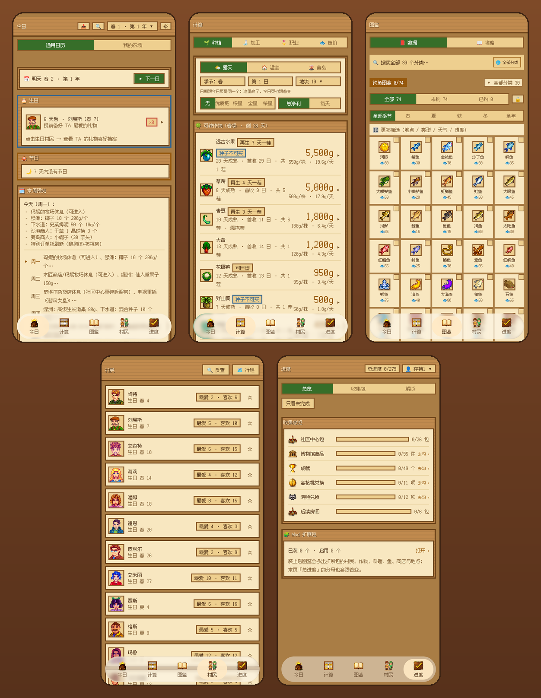

# 星露小助手 · 下载页

**完全离线的《星露谷物语》攻略助手**

[源码](https://github.com/huututu939/StardewHelper) · [更新日志](https://github.com/huututu939/StardewHelper/blob/main/CHANGELOG.md) · [问题反馈](https://github.com/huututu939/StardewHelper/issues)

---

## 下载

| 文件 | 说明 | 直链 |
|---|---|---|
| **APK（最新版）** | 4.1 MB · Android 8.0+，覆盖安装不丢存档 | [打开 Release](https://github.com/huututu939/xingluguzhushou/releases/latest)（在 Assets 里选 `.apk`） |
| 全部版本 | 历史 APK 与各版说明 | [Release 列表](https://github.com/huututu939/xingluguzhushou/releases) |
| `send_save.bat` | 电脑端手动推存档 | [下载](https://github.com/huututu939/xingluguzhushou/releases/latest/download/send_save.bat) |
| `save_auto_push.zip` | 电脑端 SMAPI 模组 | [下载](https://github.com/huututu939/xingluguzhushou/releases/latest/download/save_auto_push.zip) |
| `index.json` | Mod 扩展包清单 | [下载](https://github.com/huututu939/xingluguzhushou/releases/latest/download/index.json) |

> 直链里的 `latest/download/<文件名>` **永远指向最新 Release 的同名资产**，
> 所以这几条链接长期有效。APK 的文件名会随版本变，拿不准时进 Release 列表挑。

## 安装

1. 下载 APK（文件名形如 `stardew-assistant_v2.152.1_c243.apk`）
2. 手机上允许「安装未知来源应用」
3. 覆盖安装即可 —— 存档解析结果、勾选记录都在，不会丢

## 长什么样

## 这是什么

「星露小助手」把游戏里查不到的东西 —— 今天该干什么、材料去哪找、这东西该送给谁、
种什么最赚 —— 做成一个**不用联网**的 Android App。今日 / 计算 / 图鉴 / 村民 / 进度
五个页签，外加存档解析、农场年报长图、桌面小组件与局域网传存档。

本仓库只放**发布产物**：APK、版本清单、整理数据、电脑端脚本与 Mod 扩展包。
源码不在本仓，在 [`huututu939/StardewHelper`](https://github.com/huututu939/StardewHelper)。

| 文件 | 是什么 |
|---|---|
| `apk/` | 安装包归档（带版本号，`stardew-assistant_latest.apk` 是最新副本） |
| `version.json` | App「检查更新」读的清单：版本号、文件名、大小、md5、更新说明 |
| `data/` | 整理后的游戏数据（CC BY-NC-SA 3.0） |
| `tools/` | 电脑端推送脚本与模组包 |
| `mods/` | Mod 扩展包与清单 |

## 电脑端：存档自动推到手机

两条路，任选其一：

- **装模组（推荐）**：下载 `save_auto_push.zip`，解压后把 `StardewAutoPush/` 文件夹
  放进《星露谷物语》的 `Mods` 目录。游戏里一保存就自动推到手机，需要先装
  [SMAPI](https://smapi.io/)（游戏 1.6 / SMAPI 4.x）。
- **手动脚本**：下载 `send_save.bat`，在电脑上双击，手动推一次。

两条路都只在**你的局域网内**传输，存档**只读不改**，不经过任何服务器。
同一个 `save_auto_push.zip` 也能在 App 内「从电脑接收 → 下载到手机」拿到，两边逐字节一致。

## Mod 扩展

App 内「村民 → 扩展」可以下载第三方扩展包，清单是 [`mods/`](./mods/) 下的 `index.json`
（也可以换成自建仓库或单包 `.zip` 直链）。

- 【Stardew Valley Expanded（星露谷扩展 SVE）】扩展包的 NPC 数据与头像素材来自该 Mod
  —— **作者: FlashShifter**，来源链接: <https://www.nexusmods.com/stardewvalley/mods/3753>。
  按 Nexus Mods 授权条款使用并署名；App 只读取、不修改包内文件。
  包文件与清单见 [`mods/`](./mods/)，该 Mod 归原作者所有，与本项目及 ConcernedApe 均无关联。

## 常见问题

<b>检查更新转圈很久 / 失败？</b>

更新走 GitHub Release，部分网络环境访问 GitHub 不稳定。可以稍后重试，
或直接在本页下载最新 APK 覆盖安装。

<b>为什么下载链接不是 raw.githubusercontent.com？</b>

`raw.githubusercontent.com` 在境内多数网络下**不可达**；Release 资产的下载域名
境内可达，而且响应带 `Content-Disposition: attachment`（浏览器会落盘而不是当文本打开），
还免认证。所以本仓所有下载都走 Release 资产。

<b>卸载会丢进度吗？</b>

会。勾选记录与导入的存档解析结果存在 App 私有目录。换机前请先在
「设置 → 💾 进度备份」导出 JSON。

## 联网口径

攻略与数据功能全部离线可用。App 的联网行为只有两类：① 每次打开 App 时静默检查一次更新
（可在设置里关掉）；② 你主动点的「检查更新」、「下载电脑脚本」、「Mod 扩展」页里的
下载 / 刷新清单，以及「从电脑接收」（后者只连同一个 WiFi，不往外发数据）。

## 数据来源与协议

本仓**不含 App 源码** —— 源码在 [`huututu939/StardewHelper`](https://github.com/huututu939/StardewHelper)，
已开源（MIT + CC BY-NC-SA 分层协议，见该仓 [`LICENSING.md`](https://github.com/huututu939/StardewHelper/blob/main/LICENSING.md)）。
根目录的 MIT License **覆盖 [`tools/`](./tools/) 下的电脑端脚本与电脑端模组**（都是本项目自己的作品）；
`data/` 适用 CC BY-NC-SA 3.0、`apk/` 是构建产物（包内各第三方协议见 App 内
「设置 → 关于 → 数据来源与协议」），三者互不覆盖 —— 范围说明见根目录 [`LICENSE`](./LICENSE)。

- 游戏数据整理自 **Stardew Valley Wiki**（[英文站](https://stardewvalleywiki.com/) / [官方简中站](https://zh.stardewvalleywiki.com/)），内容遵循 **CC BY-NC-SA 3.0**；整理后的数据以同一协议开源在本仓 [`data/`](./data/)（JSON 清单见 `data/` 目录本身，协议见 `data/LICENSE`，说明见 `data/README.md`）
- 界面字体为缝合像素字体 [Fusion Pixel Font](https://github.com/TakWolf/fusion-pixel-font)（TakWolf）的子集，以 **SIL OFL 1.1** 授权使用（子集更名为 TutuPixel，协议全文随 APK 内置）
- 底栏液态玻璃效果的算法移植自 [AndroidLiquidGlass](https://github.com/Kyant0/AndroidLiquidGlass)（Kyant），以 **Apache License 2.0** 授权使用；本项目对其着色器与效果链做了修改，协议全文随 APK 内置
- 《星露谷物语》(Stardew Valley) 的游戏素材、名称与商标归 **ConcernedApe** 所有。本应用为**非官方粉丝工具**，与 ConcernedApe 无关联、未获其背书
- **Steam** 是 **Valve Corporation** 的注册商标，Steam 云存档功能由 Valve 提供。本应用为**非官方粉丝工具**，与 Valve / ConcernedApe 均无关联、未获其背书。「从 Steam 云获取存档」只把 Steam 官方页面交给**用户自己的浏览器**打开，账号密码由用户本人输入，本应用**不获取、不记录**；下载下来的存档只在本机本地读取解析，**不上传任何服务器、不再分发**

## 给开发者

- App 读取的版本清单：`https://github.com/huututu939/xingluguzhushou/releases/latest/download/version.json`
  （字段：`versionCode` / `versionName` / `date` / `notes` / `apk` / `size` / `md5`）
- Mod 扩展清单：`.../releases/latest/download/index.json`，App 内可改成自建仓库地址或单包 `.zip` 直链
- 归档包在 [`apk/`](./apk/)，按版本号命名；`stardew-assistant_latest.apk` 是最新副本
